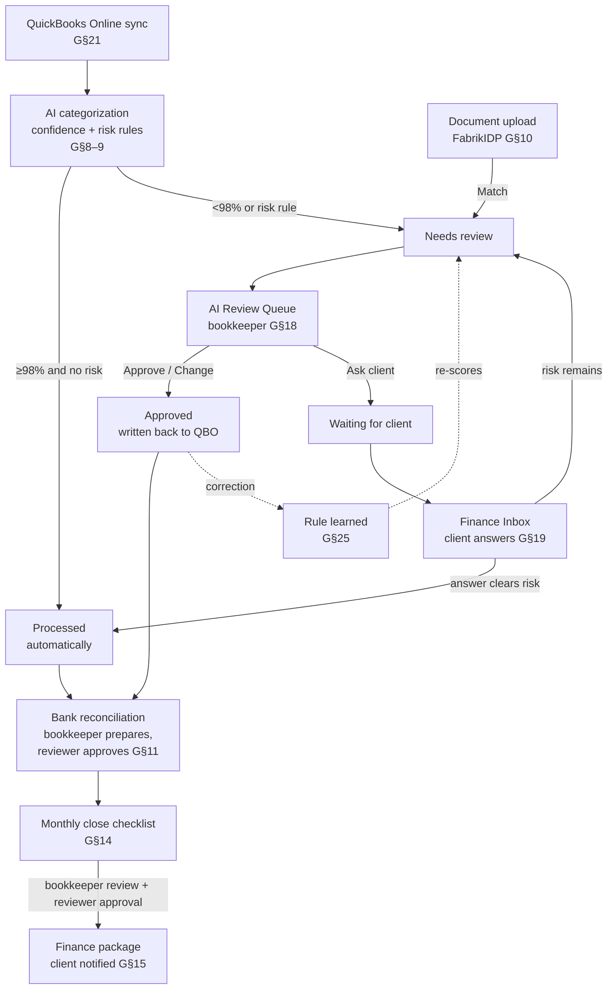

# Fabrik Finance — App Workflow

> **Last updated:** 2026-10-19 · matches branch `design/ui-polish` (main + speed changes + UI redesign)
> **Keep this file current.** Any change to screens, routes, buttons, statuses, roles, permissions, navigation, server actions, seed data or feature flags must update this file in the same commit. See [How to maintain this file](#16-how-to-maintain-this-file).

This document describes, step by step, how the Fabrik Finance prototype works for every role, and links each step to the PRD.

**PRD references** (`Fabrik Finance PRD.pdf`)
- **G§n** = *MVP Product Requirements Document*, pp. 1–31: the general AI-first bookkeeping MVP.
- **E§n** = *Product Requirements Document — Expo MVP*, pp. 34–65: the January 2027 Land Investment Expo release.
- **Where G and E conflict, E governs the client portal** (see [DECISIONS.md](DECISIONS.md)).
- Pages 32–33 are a Fondo integration comparison, not requirements.

**Feature flags**
- `SHOW_EXTRAS` is **off** by default. Items marked **[extras]** only appear when it is `true`.
- `FABRIK_DEMO_MODE` is **on** by default. Items marked **[demo]** only appear in demo mode.

---

## Contents

1. [The product in one minute](#1-the-product-in-one-minute)
2. [Roles, demo users and navigation](#2-roles-demo-users-and-navigation)
3. [The end-to-end bookkeeping loop](#3-the-end-to-end-bookkeeping-loop)
4. [Sign-in, sessions and organizations](#4-sign-in-sessions-and-organizations)
5. [Client portal workflows](#5-client-portal-workflows)
6. [Bookkeeping workflows (Fabrik staff)](#6-bookkeeping-workflows-fabrik-staff)
7. [Monthly close and finance package](#7-monthly-close-and-finance-package)
8. [Intelligence: Funding, CFO, Ask Fabrik](#8-intelligence-funding-cfo-ask-fabrik)
9. [Operations Portal](#9-operations-portal)
10. [QuickBooks, notifications and audit](#10-quickbooks-notifications-and-audit)
11. [The Expo demo flow (E§29), click by click](#11-the-expo-demo-flow-e29-click-by-click)
12. [Status reference](#12-status-reference)
13. [Permission matrix](#13-permission-matrix)
14. [PRD traceability](#14-prd-traceability)
15. [Gaps, deviations and known limitations](#15-gaps-deviations-and-known-limitations)
16. [How to maintain this file](#16-how-to-maintain-this-file)

---

## 1. The product in one minute

Fabrik Finance is an AI-first finance platform for agricultural and land businesses (E§1). **QuickBooks Online stays the ledger** (G§21, E§1). Fabrik reads from it, categorizes transactions with AI, asks a person only when needed, closes the books each month and turns the numbers into decisions: forecast, scenarios, funding and Q&A.

There are two applications in one codebase (G§1):

| Application | Users | Entry point |
|---|---|---|
| **Client Portal** | Business Owner, Client Finance User (and the proposed External Accountant) | `/` (Home) |
| **Operations Portal** | Fabrik Bookkeeper, Reviewer, Admin | `/ops` (staff also use every client screen for the organization they have open) |

The core principle (G§1, E§23): **AI does routine work; people handle exceptions.** The client is interrupted only through the Finance Inbox.

---

## 2. Roles, demo users and navigation

### 2.1 Roles (G§3: "RBAC from the beginning")

| Role | PRD purpose | In the app |
|---|---|---|
| **Business Owner** | Customer administrator | Full client access: approves bills and reminders, edits the funding profile, manages team, integrations and settings |
| **Client Finance User** | Customer employee / accountant | Same as the owner, except managing team, integrations and settings |
| **Fabrik Bookkeeper** | Processes exceptions | Review queue, Ask client, reconciliation work, bookkeeper close review |
| **Fabrik Reviewer** | Reviews / approves bookkeeping | Everything a bookkeeper does, plus approve reconciliations, approve & close books, reassign work |
| **Fabrik Admin** | Customer/user/system administration | Everything a reviewer does, plus Administration, demo reset, team/integrations/settings for any org |
| *External Accountant / CPA* | **Not a PRD role** (proposed) | Read-mostly: Books, Close, Documents, Ask, Inbox. Hidden from the invite picker and the demo login (cleanup decision D2) |

The full matrix is in [§13](#13-permission-matrix). The source is `src/server/auth/permissions.ts`.

### 2.2 Demo users (E§28)

- Password for all demo accounts: **`FabrikDemo!2026`**.
- Demo clock: **2026-10-16** (`FABRIK_CLOCK`).
- **[demo]** The login page offers a persona dropdown for the first five users below: pick one → **Sign in as <name>**.

| User | Email | Role | Organizations |
|---|---|---|---|
| Dan Smith | `dan@smithfamilyfarms.example` | Business Owner | Smith Family Farms |
| Karen Smith | `karen@smithfamilyfarms.example` | Client Finance User | Smith Family Farms |
| Sarah Chen | `sarah.chen@fabrik.example` | Fabrik Bookkeeper | Smith (bookkeeper) + 8 portfolio clients |
| Marcus Reed | `marcus.reed@fabrik.example` | Fabrik Reviewer | Smith (reviewer) + 12 portfolio clients |
| Priya Nair | `priya.nair@fabrik.example` | Fabrik Admin (MFA on) | All 25 organizations |
| Linda Park, CPA | `linda@parkcpa.example` | External Accountant | Smith |
| Tom Alvarez, Jess Kim | `…@fabrik.example` | Fabrik Bookkeeper | 8 portfolio clients each |
| Elena Rossi | `elena.rossi@fabrik.example` | Fabrik Reviewer | 12 portfolio clients |

**Smith Family Farms LLC** (the permanent demo company, E§28)
- Location and business: Story County, Iowa; corn and soybeans; 2,400 acres (800 owned, 1,600 rented); 8 employees; owners Dan 60% / Karen 40%.
- Seeded figures: Cash $482K · Revenue YTD $3.8M · Expenses YTD $3.18M · Net income $620K · Receivables $310K · Upcoming bills $184K.
- Bank accounts: Farmers State Bank ••••4821, Chase Business ••••1245, Farm Credit Savings ••••7730, Chase Ink card ••••9012.
- Close status: books closed through August 2026; **September 2026 is in review**; October is open.
- Six open inbox items: 2 transactions, 1 bill approval, 1 missing document, 1 funding question, 1 overdue invoice.

**Portfolio:** 24 more clients for the Operations Portal (19 current, 3 needing attention, 2 at risk).

### 2.3 Navigation per role (E§5; extras off)

The source is `src/app/(app)/layout.tsx`.

| Group | Business Owner / Finance User | Fabrik Bookkeeper / Reviewer | Fabrik Admin | External Accountant |
|---|---|---|---|---|
| **Overview** | Home, Finance Inbox (badge = open items) | same | same | same |
| **Finance** | Books, Monthly Close, Bills, Collect | Books (badge = items to review), **Reconciliation**, Monthly Close, Bills, Collect | same as staff | Books, Monthly Close |
| **Intelligence** | Funding, CFO, Ask Fabrik | same | same | Ask Fabrik |
| **Documents** | Documents | same | same | Documents |
| **Manage** | Integrations, Settings | same | same | — |
| **Fabrik Operations** | — | Operations, Work Queue, AI Review Queue, Clients | + Administration | — |

**On every screen**
- The floating **Ask Fabrik** button (except on `/ask`).
- The notifications bell.
- The QuickBooks sync chip ("QuickBooks synced …" or "QuickBooks needs attention").
- The organization switcher (when the user has more than one organization).
- The user menu (Profile & security, Sign out).

**[extras]** adds Tax & Credits, the Requirements matrix, and global search (Ctrl K).

**Navigation speed**
- A click shows a page-shaped loading skeleton immediately (`src/app/(app)/loading.tsx`), and the new page fades in.
- Hovering or focusing a sidebar link prefetches that page. The prefetched page is reused for up to 30 seconds.

---

## 3. The end-to-end bookkeeping loop

This is the workflow the whole product is built around: G§8 → G§9 → G§18 → G§19 → G§11 → G§14 → G§15.

What happens to a transaction, step by step:

1. **Sync.** QuickBooks data is imported (manually with "Sync now", or by the seeded schedule). Records are upserted by QuickBooks id, so nothing duplicates.
2. **Categorize** (`src/server/engines/categorization.ts`). Fabrik proposes vendor, type, category, GL account, confidence and an explanation.
   - Signals are tried in order: learned org rules → vendor history → description keywords → *Uncategorized*.
   - A possible duplicate or an unusual amount lowers the confidence.
3. **Risk check** (`src/server/engines/risk.ts`). Any enabled risk rule that matches forces human review, whatever the confidence: "Risk rules override confidence" (G§9, E§7). The 15 rules are:
   - loans, equity, shareholder, intercompany, large transaction, unusual journal entry, tax payment, payroll adjustment, asset purchase, refund, chargeback
   - unknown vendor, **supporting document required** (expense ≥ $10K with no document), possible duplicate, unusual amount
4. **Decide** (thresholds per organization, defaults from G§8 / E§7):
   - **≥ 98%** and no risk → **Processed** (automatic).
   - **≥ 85%** → **Needs review** (bookkeeper review).
   - **< 85%** → **Needs review**, flagged "Client input suggested" (clarify).
5. **Review.** The bookkeeper works the AI Review Queue ([§6.1](#61-ai-review-queue-g18-e24)):
   - **Approve** → **Approved** and written back to QuickBooks.
   - **Change** → approved with the new account, and a rule is learned.
   - **Ask client** → **Waiting for client**, and a question goes to the Finance Inbox.
   - **Escalate** → a high-priority work item for the reviewer.
6. **Client answers** in the Finance Inbox ([§5.2](#52-finance-inbox-g6-g19-e23)).
   - The "unknown vendor" and "unusual amount" flags clear.
   - If no other risk remains, the transaction becomes **Processed** with the client's category. Otherwise it returns to **Needs review**.
7. **Learn** (G§25). A human correction creates a vendor (or description) rule. Every still-open review item is re-scored immediately, and items that now reach the threshold become Processed.
8. **Reconcile** each bank and card account ([§6.3](#63-bank-reconciliation-g11)). The bookkeeper resolves exceptions until the difference is $0, then a reviewer approves.
9. **Close the month** ([§7](#7-monthly-close-and-finance-package)). The checklist completes from live data. The bookkeeper marks review complete, then a different person (the reviewer) approves and closes.
10. **Finance package** is generated and the client is notified that "September books are ready" (G§15, G§22).

---

## 4. Sign-in, sessions and organizations

**PRD:** G§4.1, G§26, E§26.

| Step | Screen | What happens |
|---|---|---|
| Sign in | `/login` | Email + password → **Sign in**. Errors: "Enter your email and password." / "That email and password don't match an active account." Timing is the same for unknown emails. **[demo]** "Expo demo accounts" box: a persona dropdown (name — role) and a **Sign in as <name>** button. |
| Throttling | — | 6 failed attempts per email+IP in 15 minutes → "Too many attempts. Wait 15 minutes or reset your password." |
| MFA | `/login/mfa` | Users with MFA (Priya) enter a 6-digit authenticator code → **Verify and continue**. **[demo]** The current code is shown for the demo secret. |
| Landing | — | Staff → `/ops`; clients → `/` (Home). |
| Forgot password | `/forgot-password` | **Send reset link**. The response is always "Check your email…". The link expires in 1 hour. **[demo]** Emails go to the development outbox (Operations → Administration). |
| Reset / accept invite | `/reset-password?token=…` | "Choose a new password" (or "Set up your account" for an invite). Policy: 12+ characters, upper and lower case, a number. Success signs out all sessions → `/login?reset=1` ("Password updated"). |
| Session | — | Signed httpOnly cookie. **2 h idle timeout, 12 h absolute.** A fresh session id at every sign-in. |
| Opening the app | any page | Opening the app from outside it — typed URL, bookmark, new tab, or a link from another site or email — always lands on `/login` and ends the earlier session (`src/proxy.ts`, using the browser's `Sec-Fetch-Site`). Reloading a page and moving around inside the app keep the session. Not affected: `/forgot-password`, `/reset-password` (emailed links), `/login/mfa` and the API. The server-side session record is not deleted here; it expires on the idle timeout. |
| Switch organization | Header org switcher | "Switch organization" popover with search. Access is checked server-side, and the switch is audited (`auth.organization_switched`). |
| Sign out | User menu → **Sign out** | Session deleted → `/login`. Audit `auth.logout`. |

**Who can open which organization** (tenant isolation, G§26)
- Clients: through their memberships.
- Fabrik Admin: every organization.
- Bookkeepers and reviewers: only organizations where they are the assigned bookkeeper, reviewer or dedicated accountant.

**Unauthenticated requests**
- Pages redirect to `/login`.
- Server actions return "Your session has ended. Sign in again."
- A missing permission returns "You don't have permission to do that."

---

## 5. Client portal workflows

### 5.1 Home (G§5, E§6, Flow step 1)

**Who:** every role. It is the landing page for clients.

1. **Attention banner** (E§23, G§5 "Attention required"). It appears only when inbox items are open.
   - Text: "Fabrik needs your help · *N* items need your input", with a breakdown ("2 transactions, 1 bill approval, 1 missing document, 1 funding question, 1 overdue invoice").
   - **Review →** opens the Finance Inbox.
2. **Six KPI cards** (E§6, which overrides the current-month KPIs in G§5). Each card is a link:

   | KPI | Opens |
   |---|---|
   | Cash | CFO forecast |
   | Revenue YTD, Expenses YTD, Net income YTD | Books → Reports |
   | Receivables (hint "$X over 30 days") | Collect |
   | Upcoming bills (hint "$X due this week") | Bills |

3. **Revenue vs expenses** chart: 3M / 6M / 12M / YTD (E§6).
4. **Fabrik Finance Brief** (E§6), marked "AI-generated". Each line links to its data:
   - revenue change YTD → Reports
   - the largest expense category rising > 8% → Books filtered to that account
   - receivables over 30 days → Collect
   - 13-week cash sufficiency → CFO forecast
   - high-potential funding programs → Funding
5. **Books status card** (G§5):
   - "*Month* books": the earliest unclosed past period.
   - A completion % and the 8 close tasks with done / in-progress / to-do marks.
   - **View monthly close →**.

**[extras]** "Message your team" sends an `accountant_question` to the Finance Inbox.

### 5.2 Finance Inbox (G§6, G§19, E§23)

**Who:** anyone with `inbox:respond` (all roles). Bill buttons also need `bills:approve` (Owner and Finance User only).

- **Tabs:** "Needs your input" (open items, high priority first, then oldest) · "Answered" (answered, resolved, dismissed).
- **Header badge:** "*N* open" or "All clear".

Each item type has its own card and action:

| Type (PRD) | Card | Action → result |
|---|---|---|
| **Transaction clarification** (G§6, G§19) | "Fabrik thinks" + one button per option with its confidence %; "Something else / add a comment" | The answer removes the *unknown vendor* and *unusual amount* flags. If a category was picked and no other risk remains: transaction → **Processed** (pending write-back). Otherwise → **Needs review**. The item becomes **Resolved**; the comment is saved to the transaction memo. |
| **Bill approval** (E§10, E§23) | Vendor, Bill #, Due, Amount, optional note, "View invoice" | **Approve** / **Request review** / **Reject** → bill status changes; item **Resolved** |
| **Missing document / receipt** (G§6, E§23) | Upload box (PDF or image, ≤ 15 MB); **[demo]** "Use sample JD invoice" | Upload → FabrikIDP extracts. If it matches the related transaction it is linked automatically and the item resolves; otherwise "Uploaded — no confident match yet. Your bookkeeper will link it." **I don't have it** answers the item. |
| **Overdue invoice** (E§23) | "Customer · Invoice · $ · N days past due" | **Draft a reminder** → Collect drawer. **Not now** → Dismissed |
| **Funding information request** (E§23) | "Base acres" field | **Save to profile** → writes `baseAcres` to the farm profile; item Resolved |
| **Other** (accountant question, monthly-close question, integration problem, vendor/customer clarification) | Free-text answer | **Send** → Answered · **Dismiss** → Dismissed |

**Items also close automatically when:**
- the transaction is approved by staff;
- the bill is decided in Bills;
- a document is matched;
- a collection reminder is sent.

**Notification:** one bundled notification per organization, "Fabrik needs your help with *N* items" (G§22 "bundle them intelligently"). It is removed when nothing is open.

### 5.3 Books: transactions and reports (G§7, G§8, G§12, E§7, E§8, Flow step 2)

**Transactions tab**
- Columns: Date · Vendor / Description · Amount · Account · Category · AI confidence · Status (E§7). 50 rows per page.
- Status tabs with counts: All · Needs review · Waiting for client · Processed · Approved · Excluded (G§7).
- Filters (G§7 / E§7):
  - search (payee, description, amount)
  - date (All / 30 days / 90 days / YTD)
  - account, category, vendor
  - AI confidence (High · auto / Medium · review / Low · clarify)
  - min/max amount
- Markers: a paperclip means a document is attached; a shield means a risk rule hit. Suggested categories are shown in purple with a sparkle until final.

**Transaction detail drawer** (G§7 "explainability")
- Amount, description, status.
- Fabrik category ("suggested" until final), transaction type, normalized vendor.
- **AI recommendation**: account, confidence badge, "Reason: …" (for example "…11 of the previous 12").
- Risk box "Needs a person — risk rules override confidence" with the rule badges.
- Supporting documents, or "No document attached — purchases over $10,000 need an invoice."
- **Audit trail (n)**: collapsible.
- Staff also see: model version, decision and thresholds, and the write-back state (Synced / Pending / Error).

**Drawer actions** (need `transactions:review`: Owner, Finance User, staff)

| State | Buttons |
|---|---|
| Needs review / Waiting for client | **Approve** (primary) · **Change** → "Choose category…" → **Save & approve** · staff only, when Needs review: **Ask client** → "Question for the client" → **Send to Finance Inbox** · if flagged as a duplicate: **Exclude duplicate** |
| Processed / Approved | **Recategorize** → choose a new account → **Save** |

**What Approve does**
- Transaction → **Approved**, reviewer recorded.
- Written back to QuickBooks ("Approved and written back to QuickBooks").
- Related inbox items resolve.
- If the account was changed, a rule is learned and open items are re-scored: "Approved — Fabrik learned "*Vendor → Account*" and auto-categorized *N* more".

**Reports tab** (G§12, E§8)
- **Profit & Loss**: Monthly / Quarterly / Annual columns, year select.
- **Balance Sheet**: as of a date.
- **Cash Flow**: operating / investing / financing, from–to dates.
- All reports are accrual basis. Lines link back to the filtered transactions. "Items still awaiting review appear under Uncategorized until approved."
- **PDF** and **Excel** export (needs `reports:export`; audited `report.exported`).

**[extras]** "AI rules" tab listing learned rules.

### 5.4 Documents: FabrikIDP (G§10, E§9, Flow step 3)

**Who:** upload needs `documents:upload`; Match needs `documents:match` (Owner, Finance User, staff).

1. **Upload.**
   - Drag & drop or **Choose files**. PDF, PNG, JPEG or WebP, ≤ 15 MB each, up to 10 at a time.
   - Type: auto-detect, Invoice, Receipt, Bank statement or Credit-card statement (the four E§9 types).
   - While processing: "FabrikIDP is reading your document…".
   - **[demo]** **Sample John Deere invoice** (JD-28712, $14,820).
2. **Extract.** FabrikIDP (or the local PDF extractor) reads vendor, document number, document date, due date, PO number, subtotal, tax, total, currency and line items, each with a confidence.
   - Status → **Extracted**, or **Needs review** if vendor or total is uncertain.
   - Images without FabrikIDP need manual field entry.
3. **Match** (invoices and receipts only).
   - Fabrik finds up to 3 outflow transactions within 60 days, scored on amount (must match within 1%), vendor name, date and document number. Confidence is capped at 99%.
   - The drawer shows "Possible transaction · Match confidence: N%" with reasons.
4. **Act in the drawer:**
   - **Match** → document **Matched**, linked to the transaction, related missing-document requests resolve, and the transaction is re-scored. The document now satisfies "supporting document required", so it can finalize: "Matched — supporting document cleared the review flag and the transaction was finalized".
   - **Not this one** → removes the suggestion.
   - **Correct fields** → "Confirm the key fields" → **Save & match** (re-runs matching).
   - No match on an invoice → pick a category → **Create bill** → a new bill in **Needs review** in Bills.
5. **Tabs:** All · Invoices · Receipts · Statements. **[extras]** "Entity & farm".
6. **List size:** the table shows 50 documents at a time; **Show *N* more** loads the next 50. Changing the tab or search starts again at 50.

### 5.5 Bills Lite (E§10)

**Who:** approve needs `bills:approve` (Business Owner and Client Finance User only). Staff see bills but do not approve them.

- **KPIs:** Outstanding · Due this week · Overdue.
- **Tabs:** Open · All.
- **Columns:** Vendor · Invoice # · Amount · Invoice date · Due date ("· overdue" in red) · Category · Status.
- **Actions** on any bill that isn't approved, paid or rejected:
  - **Approve** → "Bill approved — it now feeds the cash forecast"
  - **Request review** → Needs review
  - **Reject** → Rejected
- Every decision is kept in the bill history and the audit trail.
- **No payment execution** (E§10, E§31). Paid bills can't be changed.

### 5.6 Collect Lite (E§11)

**Who:** draft or discard needs `collect:draft_reminder` (clients and staff). **Approve & send** needs `collect:approve_reminder` (Business Owner and Client Finance User only).

1. **Aging:** "Outstanding AR · $310K" split into Current / 1–30 / 31–60 / 60+ days.
2. **Invoice list:** Customer · Invoice # · dates · Amount · Outstanding · Days overdue · Status · **Fabrik recommends**. Sorted most overdue first.
3. **Send reminder** (overdue invoices) opens the reminder drawer → **Generate reminder**.
   - Fabrik drafts a friendly, firm (> 45 days) or final (> 120 days) message.
4. **Review** the "AI draft — review before sending": edit the subject and message → **Approve & send** (or **Discard**). The user must approve every message (E§11).
5. **Sent** → the reminder is recorded and the related overdue-invoice inbox item resolves.
   - **[demo]** The email goes to the development outbox, not the customer.

Automated dunning is out of scope (E§11, E§31).

### 5.7 Settings (G§4.1, E§5 "Manage")

Tabs are shown by permission:

| Tab | Who | Contents |
|---|---|---|
| **Team** | `team:read` (clients, staff) | **Members:** role, status, 2FA. With `team:manage` (Owner, Admin): **Invite someone** (email, name, role: Business Owner or Client Finance User) → invite email → "Set up your account"; change role; remove (an org must keep at least one owner). **Your Fabrik team:** bookkeeper and reviewer. |
| **Profile & security** | everyone | Name, title, email and in-app notification toggles (**[extras]** digest). **MFA:** "Set up two-factor authentication" → QR code → 6-digit code → **Verify & turn on**; "Turn off two-factor" needs a current code. Password reset link. |
| **AI & rules** | `team:read` | **AI confidence thresholds:** auto %, review %, large-transaction $. Editable with `settings:manage` (Owner, Admin); saving re-scores live items. **Risk rules:** read-only. **Learned rules:** staff can switch them on or off. |
| **Audit trail** | `audit:read` | See [§10.3](#103-audit-trail-g20-e25). |
| **[extras]** Bookkeeping | `team:read` | Close frequency, accounting setup |

---

## 6. Bookkeeping workflows (Fabrik staff)

### 6.1 AI Review Queue (G§18, E§24)

**Who:** all Fabrik staff. Screen: Operations → **AI Review Queue** (`/ops/review`).

1. Pick a client: the "Client" picker shows "*name* — *N* to review", busiest first. Opening it switches the active organization.
2. The queue shows **only uncertain transactions** (status Needs review), riskiest first, then lowest confidence (G§18 "Bookkeeper sees only uncertain transactions"). The first 200 are shown.
3. Each card shows: vendor, date, amount, AI recommendation, confidence, "Reason: …", risk rule badges, and "Escalated" or "Client input suggested" badges.
4. Actions per card (G§18, E§24):

   | Button | Result |
   |---|---|
   | **Approve** | Approved + QuickBooks write-back; the card leaves the queue |
   | **Change** → Account (AI alternatives first) + comment → **Approve with change** | Approved with the new account, rule learned, queue re-scored |
   | **Ask client** → AI-drafted question → **Send to client** | Transaction → Waiting for client; Finance Inbox item + notification (with email) |
   | **Escalate** → note (required) → **Escalate** | High-priority work item assigned to the org's reviewer; memo "Escalated: …". The card stays in the queue. |

5. **Bulk approval** (G§18): select rows (or "Select all") → **Approve *N* as suggested**. Items flagged "Client input suggested" are skipped: "*k* need a decision first".
6. **Time tracking:** the seconds spent on each card are recorded as `humanSeconds`. This feeds the north-star metric ([§9.1](#91-operations-dashboard-g16-g27-e24)).

**[extras]** Keyboard shortcuts: J/K move, A approve, C change, Q ask, E escalate, X select.

### 6.2 Client question loop (G§19)

This is the PRD's "no email chains" loop. It involves both portals:

1. **Bookkeeper** clicks **Ask client** (Review Queue or Books drawer). Fabrik drafts the question, for example "We found a $1,482 … purchase … Was this for …?", with category options and confidences.
2. **Transaction** → *Waiting for client*. An inbox item "We need help categorizing this transaction" is created, and the bundled notification (with email) goes to the client.
3. **Client** opens Home → **Review** → Finance Inbox and taps a category (or adds a comment).
4. **Transaction returns to processing automatically**: Processed if no other risk remains, otherwise back to *Needs review* for the bookkeeper.
5. **Follow-up:** if the client hasn't answered within 3 days, the Work Queue shows "Client hasn't answered *N* items (3+ days)".

### 6.3 Bank reconciliation (G§11)

**Who:**
- Prepare: `reconciliation:work` (all staff).
- Approve: `reconciliation:approve` (Reviewer, Admin).
- Clients can open the pages read-only by URL, but the nav item is staff-only (cleanup decision D1).

1. **Reconciliation** (`/reconciliation`) has period tabs for the last three months and one card per bank or card account.
   - Each card shows statement balance, book balance, difference, and matched / unmatched / duplicates / book-only counts.
   - It shows "Statement not received" when there is no statement.
2. **Open workspace** shows the figures strip: Statement balance · Book balance · Outstanding items · Difference · Matched · Unmatched · Duplicates (G§11). Fabrik has already auto-matched lines ("Fabrik auto-matched *N* lines").
3. Resolve exceptions:

   | Section | Action |
   |---|---|
   | Statement lines without a match | **Accept** / **Reject** a suggested match (shown with its confidence %), or pick "Record as…" (bank fees and interest are pre-selected) → **Record**, which creates an approved transaction and matches it |
   | Possible duplicates in the books | **Exclude duplicate** |
   | In the books, not on this statement | **Mark outstanding** |
   | Outstanding items | **Undo** |
   | Matched lines | Show / Hide |

4. **Gate:** approval is possible only when the difference is $0 **and** there are no unmatched or suggested lines, duplicates or unreconciled book items.
   - A bookkeeper then sees "Ready — a Fabrik reviewer approves the final reconciliation." (G§11 "READY FOR REVIEW").
5. **Reviewer** clicks **Approve reconciliation** → "Approve this reconciliation? … Approval locks the reconciliation." → **Approve** (G§11 "Human approves the final reconciliation").
   - Changes after approval need **Reopen** first.
6. The close checklist's "Bank reconciliation" / "Credit card reconciliation" steps update live.

---

## 7. Monthly close and finance package

### 7.1 Monthly Close (G§14)

**Who:**
- Everyone can view.
- `close:work` (staff) completes the bookkeeper review.
- `close:approve` (Reviewer, Admin) approves & closes, and reopens.
- Clients see "Your Fabrik team completes and approves the close."

**Screen:** Monthly Close (`/close`).
- Period tabs: the current month and the 3 before it. The default is the earliest ended, unclosed month.
- The target close date is month end + 10 days (G§27 "< 10 business days").

**The close checklist** (G§14, the same 8 steps as the G§5 books-status card). Steps are derived automatically from live data where possible (G§14 "Tasks should be generated automatically where possible"):

| # | Step | Owner | Done when |
|---|---|---|---|
| 1 | Transactions categorized | AI | No transaction in the period is Needs review / Waiting for client |
| 2 | Documents processed | AI | No document in the period is processing, needs review or has an unconfirmed match |
| 3 | Bank reconciliation | Bookkeeper | Every bank account's reconciliation for the period is approved |
| 4 | Credit card reconciliation | Bookkeeper | Every card reconciliation is approved ("No credit cards" if none) |
| 5 | Client questions resolved | Client | No open inbox item for the period |
| 6 | Bookkeeper review | Bookkeeper | **Complete bookkeeper review** clicked (optional note) → period *In review* |
| 7 | Reviewer approval | Reviewer | **Approve & close books** clicked |
| 8 | Reports generated | AI | Finance package generated at approval |

**Approve & close books**
- Enabled only when steps 1–6 are done; otherwise "Waiting on: …".
- Confirmation: "Approve and close the books? Locks the period and generates the finance package."
- **Segregation of duties:** the approver can't be the org's assigned bookkeeper who completed the bookkeeper review.

**Closing does all of this:**
- period → **Closed**
- reviewer approval recorded
- package generated
- audit `close.approved`
- notification "*Month* books are ready" with email (G§22)

**Reopen period** (reason required) removes the approval and the package and returns the period to *In review*.

### 7.2 Monthly Finance Package (G§15)

**Screen:** Monthly Close → **Finance package** (`/close/{YYYY-MM}/package`).

- **Clients** see it once the period is closed. Before that: "Ready once *Month* books are closed". Staff (and clients with **[extras]**) see the draft, marked "Draft — books not closed".
- **Contents** (G§15):
  - **Executive summary** (AI-generated observations on revenue, operating expenses, payroll and cash)
  - Revenue / Expenses / Net income / Ending cash with month-on-month change
  - **Revenue & expense trend** (6 months)
  - **Major expense changes** vs prior month
  - **Notable transactions** (largest of the month)
  - **P&L**, **Balance Sheet**, **Cash Flow**
- **Download PDF** (`reports:export`).

---

## 8. Intelligence: Funding, CFO, Ask Fabrik

### 8.1 Funding (E§12–E§17, Flow step 5)

**Who:**
- Everyone except the External Accountant sees Funding.
- Editing the profile needs `funding:edit_profile` (Business Owner and Client Finance User).

1. **Farm / business profile** (E§13) at `/funding/profile`.
   - **Financials:** revenue, expenses, assets and debt, read-only "From QuickBooks Online".
   - **Entity & location:** entity, type, state, county, employees. **[extras]** EIN.
   - **Owners** (must total 100%).
   - **Land & production:** acres owned / rented, crops, livestock, properties.
   - **Equipment.**
   - **Planned investments** and project description. These drive which programs match.
   - **Business activities.**
   - **More details:** years farming, beginning farmer, base acres, conservation practices, credit / disaster / value-added / NRCS / energy-audit questions.
   - **Save profile** → "Profile saved — funding matches updated". Smith seeds at 90% complete.
2. **Funding dashboard** (E§16) at `/funding`.
   - "*N* programs identified" with High potential / Possible / More info required counts.
   - Grouped cards: agency, score, program, level, type, deadline, "Verified *date*".
   - The default view hides unlikely and dismissed programs; "Show all 12 programs in the database" toggles them.
   - Disclaimer: "Potential matches only — the administering agency or lender confirms eligibility."
3. **Program database** (E§14): 12 researched programs (FSA loans, NRCS EQIP/CSP, REAP, ARC/PLC, Iowa programs, IRS §179 …). Each has an official source URL and a last-verified date (E§30 "Funding source traceability 100%").
4. **Matching engine** (E§15).
   - The profile is checked against each program's rules → score, level, explanation, qualifying factors, missing information, disqualifiers.
   - Levels: **High potential match**, **Possible match**, **More information required**, **Unlikely match**.
   - Scores are capped at 92% ("agency review always remains"). Competitive programs are capped at Possible / 79%.
   - Fabrik never claims the business qualifies.
   - Smith seed: 3 high · 4 possible · 1 more info · 4 unlikely.
5. **Program detail** (E§16, E§17) at `/funding/{id}`.
   - Match score card.
   - **Why Fabrik identified this**: known qualifying factors / information required / potential disqualifiers.
   - **Application readiness** checklist (7 items) with "*N*% ready". ARC/PLC = **71% ready**.
   - **Documents available**: P&L, Balance Sheet and Cash Flow from closed books, plus funding-tagged documents.
   - Official source, program details.
6. **Check eligibility** → "Eligibility check requested — your Fabrik team will review it with you". The button reads "Nothing is submitted on your behalf" (E§17, E§31: no application submission).
   - **[extras]** Save / Preparing / Hide watch statuses.

### 8.2 CFO (E§18–E§20, Flow step 4)

**Who:** everyone except the External Accountant. Running scenarios needs `cfo:scenarios`.

| Tab | Contents (PRD) |
|---|---|
| **CFO dashboard** (E§18) | Cash, Revenue YTD, Expenses YTD, Net income YTD, Operating margin, Receivables (AR), Payables (AP), Cash in 13 weeks. 13-week projected cash chart. **AI insights** (revenue, equipment and fuel spend, AR over 30 days, margin; each grounded in the data). **Business ratios** (current ratio, working capital, debt-to-assets, debt service coverage). |
| **13-week cash forecast** (E§19) | Cash today, Week 13, Lowest point, Known in/out, Estimated in/out. Chart where **known amounts are solid and estimated amounts hatched**. **Week by week** table; expand a week to see each line with its source and known/estimated badge. **Assumptions** card (starting cash, collections, seasonal sales at 70% of last year, bills, payroll & debt service, variable spend, $150K buffer). "Excluded from the forecast" (invoices more than 90 days overdue). **[extras]** Seasonal-sales slider, buffer, include-estimates toggle. |
| **Scenarios** (E§20) | Five types: **Purchase farmland**, **Purchase equipment**, **Hire employees**, **Revenue changes**, **Largest customer stops paying**. Headline inputs; the rest under "More assumptions" (for example $1M land, 30% down, 6.75%, 25 years). **Run scenario** shows: a verdict (comfortable / caution / strain); an **Impact** table (cash in week 13, annual expenses, annual profit, total debt); a 13-week cash chart against the baseline; **Assumptions used**. **[extras]** Save. |

Approved and upcoming bills feed the forecast (E§10 "CFO integration").

### 8.3 Ask Fabrik (G§13, E§21–E§22, Flow steps 4 and 6)

**Who:** every role (`ask:use`).

**Entry points**
- The **Ask Fabrik** button at the bottom right of every page opens a drawer (G§13 "persistent button").
- The full page `/ask` has starter questions.
- `?q=` asks a question directly.

**How it answers.** A **Finance Router** picks the data source (E§22): Books, Bills, Collect, Funding, CFO or Documents. The routes are:
- **Refuse actions:** transfer, pay, approve, delete → "I can't do that — Ask Fabrik is read-only…" (G§13, E§21).
- **Funding:**
  - "What documents do we already have…" → a per-program readiness table from Funding + Books + Documents (the E§29 wow moment).
  - "What government programs…" → potential matches, with the disclaimer.
- **CFO:**
  - "Can we afford…/what if we buy/hire…" → runs a scenario, with a link "Open this scenario in CFO".
  - Forecast; cash position.
- **Documents:** "Show me the invoice for…".
- **Bills and Collect:** bills due; who owes us.
- **Books:** top vendors; profit / expense / revenue variance; vendor payments; category spend; summary.
- **[extras]** Books close status.
- **Fallback** with suggestions.

**Answers** include module badges, "Grounded in your data" / "Partial data", metrics, a supporting table ("Open supporting data"), links, **Sources** and one follow-up question.

**Grounding** (E§22 "grounded in actual customer data")
- Every number is computed.
- An optional LLM (`ANTHROPIC_API_KEY`) may only rephrase. Its output is rejected if it contains any number not in the facts.

**Audit:** each answer is recorded as `ask.answered`.

---

## 9. Operations Portal

Staff only. Non-staff see "Fabrik staff only".

### 9.1 Operations dashboard (G§16, G§27, E§24)

`/ops` "Fabrik Operations" covers the clients the user can access. The north-star figure leads in a highlighted banner, followed by two groups, **Clients** and **Transactions**:

| Figure | Meaning |
|---|---|
| Active clients | Active organizations |
| Books current / Needs attention / At risk | Client health (each links to Clients filtered) |
| AI processed / Human reviewed | Transactions in the last 30 days |
| Client questions | Clarifications sent in the last 30 days |
| Automation rate | processed ÷ (processed + approved + needs review + waiting) |
| **Human minutes per client per month** | The north star (G§27, E§30): recorded `humanSeconds` in the last 30 days ÷ 60 ÷ clients. Hint: "*x* per 100 transactions" |

**Client health**
- **At risk:** catch-up backlog, a reconciliation difference over $5,000, or a close more than 5 days late.
- **Needs attention:** last month not closed, or a QuickBooks error.
- **Current:** otherwise.

**[extras]** "Critical metrics vs targets" card (G§27 targets).

### 9.2 Work Queue (G§17, E§24)

`/ops/queue` is a global queue, so staff don't hunt client by client. It is **generated automatically** each time Operations or Work Queue is opened, and an item closes automatically when its condition clears.

| Generated task | Trigger | Priority | Assigned to |
|---|---|---|---|
| Transaction review "*N* transactions to review" | Needs-review items | High if ≥ 20 or older than 5 days; Medium if ≥ 5; else Low | Bookkeeper |
| Missing statement | Last month's reconciliation not started | Medium | Bookkeeper |
| Reconciliation difference / ready to finish | Unapproved reconciliation with a difference or exceptions | Critical if over $5K, else High | Bookkeeper |
| Client follow-up | Inbox items unanswered 3+ days | Low | Bookkeeper |
| Close review "… close ready for reviewer approval" | Ended, unclosed period ready for approval | High | **Reviewer** |
| Integration error | QuickBooks connection in error | High | Bookkeeper |
| Catch-up bookkeeping | Client months behind | Medium | Bookkeeper |
| Document review | Documents needing field review | Low | Bookkeeper |
| Escalation (manual) | **Escalate** in the Review Queue | High | Reviewer |

- **Filters** (G§17): Client · Bookkeeper · Task type · Priority · Month · Status.
- **Columns** (E§24): Priority · Client · Task (opens it in that client) · Type · Age · Assigned · Status.
- **Status:** Open / In progress / Waiting on client / Done (any staff).
- **Reassign:** Reviewer and Admin only.

### 9.3 Clients (G§29 #18 "Client Workspace")

`/ops/clients`
- **Tabs:** All · At risk · Needs attention · Current.
- **Columns:** Client, Health + reason, Close (period + %), To review, Team (bookkeeper, reviewer).
- **Actions:**
  - **Review queue** → the AI Review Queue for that client.
  - **Open workspace** → that client's Home, showing what the client sees.
  - Both switch organization first.

**[extras]** Questions column.

### 9.4 Administration (G§23)

`/ops/admin` needs `admin:manage` (Fabrik Admin only).

- **Organizations:** plan, status, bookkeeper, reviewer, close frequency. Changes are audited. **[extras]** Dedicated accountant.
- **Fabrik staff:** change role or disable access (disabling signs the user out). You can't change your own role.
- **Risk rules:** switch each of the 15 rules on or off ("affects new and reprocessed transactions").
- **[demo]** **Development email outbox:** the last 50 emails sent (reminders, invites, resets, notifications).
- **[demo]** **Reset demo data:** restores the seeded Smith Family Farms story; everyone signs in again.

---

## 10. QuickBooks, notifications and audit

### 10.1 QuickBooks Online (G§21, E§7)

**Screen:** `/integrations`. Needs `integrations:read`; External Accountants have no access.

- **Imports:** chart of accounts, accounts, transactions, vendors, customers, invoices, bills, journal entries, reports. **Only approved categorizations are written back.**
- **Status card:**
  - company, connected by, last sync, pending write-backs
  - **Sync history:** started, trigger, status, records fetched, error
- **Buttons:**
  - **Sync now:** anyone with `integrations:read`.
  - **Reconnect** and **Disconnect:** `integrations:manage` (Business Owner, Fabrik Admin).
- **Reliability** (G§21):
  - Idempotency keys per run.
  - Upsert by QuickBooks id ("0 duplicates created").
  - Up to 3 attempts with exponential backoff for retryable errors.
  - Every run is audited.
- **On failure:**
  - Notification "Your QuickBooks connection needs attention" (with email).
  - A red sync chip in the header.
  - An error notice on Integrations.
  - A high-priority "Integration error" work item for the bookkeeper.
  - The next successful sync clears all of these.
- **[demo]** "Demo controls" → **Simulate next sync failure**.
- The demo uses a synthetic QuickBooks sandbox. The live OAuth adapter exists but isn't linked from the UI (see [§15](#15-gaps-deviations-and-known-limitations)).

### 10.2 Notifications (G§22)

**Channels:** in-app (bell) and email (development outbox). They are bundled, never one per transaction:

| Bundle | When | Email |
|---|---|---|
| "Fabrik needs your help with *N* items" | Inbox items open; updated as they change; removed when none | When a question is sent to the client or an inbox item is created; at most every 4 h for an existing bundle |
| "*Month* books are ready" | Reviewer closes the period | Yes |
| "Your QuickBooks connection needs attention" | Sync failure; cleared on success | Yes |

- Email goes only to client members (not External Accountants) with email notifications on.
- Invites, password resets and collection reminders are sent as direct emails.

### 10.3 Audit trail (G§20, E§25)

Every material AI and human action is recorded, append-only (`src/server/services/audit.ts`). Each event holds:
- time
- actor (user / AI / system, with role)
- action
- record
- before → after
- AI recommendation, confidence, model and model version
- risk level and reasons
- comment
- human seconds

**Where to see it**
- **Transaction drawer** → "Audit trail (n)". This shows the G§20 example: "AI suggested … 87%", then "Sarah changed …", then "Transaction approved".
- **Settings → Audit trail:** every event for the organization. Filter, 50 per page, columns Time · Actor · Action · Record · Change · Details.

---

## 11. The Expo demo flow (E§29), click by click

This is the 5–10 minute story (E§2): *Connect → understand → explain → forecast → funding → ask*. Sign in as **Dan Smith**.

| Step | PRD | Clicks | What the audience sees |
|---|---|---|---|
| 1 Home | E§29.1, E§6 | Sign in → Home | Cash $482K · Revenue YTD $3.8M · Expenses $3.18M · Net income $620K · Receivables $310K · Upcoming bills $184K; the Finance Brief; "6 items need your input" |
| 2 Books | E§29.2, E§7 | Books → search "Deere", "Pioneer", "Casey's" → open a row | John Deere → Equipment / Machinery, seed supplier → Seed, fuel → Fuel & Oil, each with confidence, reason and audit trail |
| 3 Document AI | E§29.3, E§9 | Documents → **Sample John Deere invoice** → **Match** | FabrikIDP extracts JD-28712, $14,820.00; "Possible transaction … Match confidence: 99%"; the transaction finalizes and the inbox request disappears |
| 4 CFO | E§29.4, E§19–20 | CFO → 13-week forecast → expand a week → Assumptions; then **Ask Fabrik**: "Can we afford to purchase another $1 million of farmland?" | Known vs estimated cash; a verdict with low point, debt-to-assets, DSCR and assumptions; "Open this scenario in CFO" |
| 5 Funding | E§29.5, E§16–17 | Funding → **Agriculture Risk Coverage (ARC) & Price Loss Coverage** | Why Fabrik identified this, information required, documents available, **71% ready**, official source; potential matches only |
| 6 Ask Fabrik | E§29.6, E§21 | Ask: "What government programs could potentially help Smith Family Farms expand?" then "What documents do we already have for these applications?" | Programs, then a readiness table drawn from Funding + Books + Documents (**the wow moment**) |

**Optional, behind the scenes** (G§16–19):
1. Sign in as **Sarah Chen**: AI Review Queue → Approve / Change / Ask client / bulk approve.
2. **Marcus Reed**: Reconciliation → Chase ••••1245 (September) → resolve to $0 → approve → Monthly Close → **Approve & close books** → Finance Package.
3. **Operations** shows *human minutes per client per month*.

The steps above are covered by `tests/e2e/expo-demo.spec.ts`. The role walkthrough in [cleanup-summary.md](cleanup-summary.md) covers all five PRD roles end to end.

---

## 12. Status reference

| Object | Statuses (UI label) | Moves by |
|---|---|---|
| **Transaction** (G§7) | Processed · Needs review · Waiting for client · Approved · Excluded | AI decision → Processed / Needs review. **Ask client** → Waiting for client. Client answer → Processed / Needs review. **Approve** → Approved. **Exclude** → Excluded |
| **Inbox item** | Open · Answered · Resolved · Dismissed | Answer → Answered / Resolved. Related action → Resolved. **Dismiss** / **Not now** → Dismissed |
| **Document** | Processing · Stored · Extracted · Needs review · Matched · Failed | Upload → Processing → Extracted / Needs review (non-financial kinds → Stored). **Match** → Matched. **Correct fields** → Extracted |
| **Bill** (E§10) | Received · Processing · Needs review · Approved · Rejected · Paid | **Approve** / **Reject** / **Request review**. Created from a document → Needs review |
| **Invoice (AR)** | Current · 1–30 · 31–60 · 60+ days late | Derived from the due date |
| **Collection reminder** | Draft · Sent · Discarded | **Generate** → Draft. **Approve & send** → Sent. **Discard** |
| **Reconciliation** | Not started · In progress · Ready for review · Approved | Any work → In progress. Gate passes → Ready for review (derived). Reviewer → Approved. **Reopen** → In progress |
| **Close period** | Open · In review · Closed | **Complete bookkeeper review** → In review. **Approve & close books** → Closed. **Reopen period** → In review |
| **Funding match** (E§15) | High potential · Possible · More information required · Unlikely | Recomputed from the profile |
| **Work item** | Open · In progress · Waiting on client · Done | Auto-generated / auto-closed, or set by staff |
| **QuickBooks connection** | Connected · Error · Disconnected | Sync result, Reconnect, Disconnect |

---

## 13. Permission matrix

The source is `src/server/auth/permissions.ts`. Every server action checks permissions server-side (`src/server/action.ts`); the UI only mirrors them.

| Capability | Owner | Finance User | Ext. Accountant | Bookkeeper | Reviewer | Admin |
|---|:-:|:-:|:-:|:-:|:-:|:-:|
| Home, Books, Reports, Close, Documents (view), Ask | ✓ | ✓ | ✓ | ✓ | ✓ | ✓ |
| Export reports / package PDF | ✓ | ✓ | ✓ | ✓ | ✓ | ✓ |
| Answer Finance Inbox | ✓ | ✓ | ✓ | ✓ | ✓ | ✓ |
| Upload documents | ✓ | ✓ | ✓ | ✓ | ✓ | ✓ |
| Match documents | ✓ | ✓ | – | ✓ | ✓ | ✓ |
| Approve / change transactions | ✓ | ✓ | – | ✓ | ✓ | ✓ |
| Ask client, bulk approve, manage learned rules | – | – | – | ✓ | ✓ | ✓ |
| Approve bills | ✓ | ✓ | – | – | – | – |
| Draft reminders | ✓ | ✓ | – | ✓ | ✓ | ✓ |
| Approve & send reminders | ✓ | ✓ | – | – | – | – |
| Funding, CFO (view) | ✓ | ✓ | – | ✓ | ✓ | ✓ |
| Edit funding profile | ✓ | ✓ | – | – | – | – |
| Run CFO scenarios | ✓ | ✓ | – | ✓ | ✓ | ✓ |
| Integrations (view, Sync now) | ✓ | ✓ | – | ✓ | ✓ | ✓ |
| Reconnect / disconnect QuickBooks | ✓ | – | – | – | – | ✓ |
| Team (view) | ✓ | ✓ | – | ✓ | ✓ | ✓ |
| Invite / change role / remove members | ✓ | – | – | – | – | ✓ |
| Edit AI thresholds | ✓ | – | – | – | – | ✓ |
| Audit trail | ✓ | ✓ | ✓ | ✓ | ✓ | ✓ |
| Reconciliation: prepare | – | – | – | ✓ | ✓ | ✓ |
| Reconciliation: approve | – | – | – | – | ✓ | ✓ |
| Close: bookkeeper review | – | – | – | ✓ | ✓ | ✓ |
| Close: approve & close / reopen | – | – | – | – | ✓ | ✓ |
| Operations Portal | – | – | – | ✓ | ✓ | ✓ |
| Reassign work | – | – | – | – | ✓ | ✓ |
| Administration, demo reset | – | – | – | – | – | ✓ |

---

## 14. PRD traceability

Status key:
- ✅ **Built** as specified.
- 🟡 **Partial or adapted** (see note).
- 🚫 **Out of scope** per the PRD.
- 🔒 **Hidden** behind `SHOW_EXTRAS`.

### General MVP PRD (G§)

| PRD | Requirement | Where in the app | Status |
|---|---|---|---|
| G§1 | Client Portal + Operations Portal; QBO is the ledger | Whole app; `/ops` | ✅ |
| G§2 | Owner understands cash, P&L, BS, CF, status, questions, documents | Home, Reports, Inbox, Documents | ✅ |
| G§3 | Five roles, RBAC from the start | `permissions.ts` | ✅ (+ proposed External Accountant, hidden from pickers) |
| G§4.1 | Login, logout, reset, MFA, select org, invite, profile, see integrations | §4, Settings, Integrations | ✅ |
| G§5 | Dashboard KPIs, trend, books status, attention required | Home | 🟡 KPIs are YTD per E§6 (conflict C-01); books status ✅ |
| G§6 | Finance Inbox with 8 item types; structured answers | Inbox | ✅ |
| G§7 | Transactions list, filters, 5 statuses, explainable detail | Books | ✅ |
| G§8 | AI categorization fields; configurable thresholds 98/85 | `categorization.ts`, Settings → AI | ✅ |
| G§9 | Risk engine; confidence + risk → decision | `risk.ts` | ✅ (*unusual journal entry* rule has no trigger yet) |
| G§10 | FabrikIDP upload, extract, match | Documents | ✅ |
| G§11 | Reconciliation workspace; AI assists; human approves | Reconciliation | ✅ |
| G§12 | P&L / BS / CF; PDF & Excel | Books → Reports | ✅ |
| G§13 | Ask Fabrik persistent button; read-only | Ask launcher, `/ask` | ✅ |
| G§14 | Monthly close checklist, auto tasks | Monthly Close | ✅ |
| G§15 | Monthly finance package | Finance Package | ✅ |
| G§16 | Operations dashboard | `/ops` | ✅ |
| G§17 | Global client work queue + filters | `/ops/queue` | ✅ |
| G§18 | AI review queue: uncertain only, Approve / Change / Ask client, bulk | `/ops/review` | ✅ |
| G§19 | Ask client → Inbox → answer → back to processing | §6.2 | ✅ |
| G§20 | Audit trail fields | Drawer + Settings → Audit | ✅ |
| G§21 | QBO only; OAuth; import; write-back; sync status, retry, logging, dedupe, idempotency | Integrations | 🟡 Synthetic sandbox in the UI; live OAuth adapter built but not linked |
| G§22 | In-app + email, bundled | Bell, outbox | ✅ (email to the dev outbox) |
| G§23 | Admin manages customers, orgs, users, roles, bookkeepers, reviewer assignment, plans, AI thresholds, risk rules, integrations, close schedules, account status | `/ops/admin`, Settings | 🟡 AI thresholds are edited in Settings (Owner or Admin), not Administration |
| G§24 | Specialized agents + orchestration | `src/server/engines`, `services` | ✅ |
| G§25 | Rules engine learns org behaviour | Approve / Change → `learnRule` | ✅ (vendor & description rules learned; org / amount / recurring rules supported by the engine) |
| G§26 | Security: MFA, RBAC, tenant isolation, audit, sessions, secrets | §4, `SECURITY.md` | 🟡 Production infra (KMS, Secrets Manager) designed, not deployed |
| G§27 | Metrics; north star human minutes per client per month | `/ops` | ✅ (target table 🔒) |
| G§28 | Out of scope | — | 🚫 Tax filing / R&D only as a hidden preview 🔒 |
| G§29 | 18 core screens | Nav | ✅ |

### Expo MVP PRD (E§)

| PRD | Requirement | Where in the app | Status |
|---|---|---|---|
| E§2 | 5–10 minute demo story | §11 | ✅ |
| E§4 | Core: Home, Books, Documents, Funding, CFO, Ask; Supporting: Bills, Collect, Inbox, Integrations; Internal: Ops | Nav | ✅ |
| E§5 | Navigation groups | Sidebar | 🟡 Adds Monthly Close for all and Reconciliation for staff (G§11/G§14; decision D1) |
| E§6 | Home KPIs, trend (3/6/12/YTD), AI Finance Brief with links | Home | ✅ |
| E§7 | Books: QBO import, columns, filters, AI categorization, thresholds | Books | ✅ |
| E§8 | Financial reports + export | Reports | ✅ |
| E§9 | Documents: 4 types, upload, extraction, matching | Documents | ✅ |
| E§10 | Bills Lite: statuses, dashboard, Approve / Reject / Request review, feeds forecast | Bills | ✅ |
| E§11 | Collect Lite: aging, list, AI reminder, user approval | Collect | ✅ |
| E§12 | Funding categories; grant / loan / incentive distinction | Funding | ✅ |
| E§13 | Farm / business profile | `/funding/profile` | ✅ |
| E§14 | Funding database with official source + verified date | 12 programs | ✅ |
| E§15 | Matching: score, level, explanation, factors, missing info, disqualifiers; never claims eligibility | `funding-match.ts` | ✅ |
| E§16 | Funding dashboard + detail + Check eligibility | `/funding`, `/funding/{id}` | ✅ |
| E§17 | Application readiness checklist; no submission | Detail page | ✅ |
| E§18 | CFO dashboard + AI insights | CFO | ✅ |
| E§19 | 13-week forecast; inspect assumptions; known vs estimated | CFO → forecast | ✅ |
| E§20 | Scenarios with cash / expenses / debt / profit / 13-week impact + assumptions | CFO → scenarios | ✅ |
| E§21–22 | Ask Fabrik across modules via a finance router; grounded | Ask | ✅ |
| E§23 | Finance Inbox; interrupt only when needed | Inbox, Home banner | ✅ |
| E§24 | Ops dashboard, work queue, review queue (+ Escalate, bulk) | `/ops` | ✅ |
| E§25 | Audit trail | §10.3 | ✅ |
| E§26 | Security | §4 | 🟡 as G§26 |
| E§27 | Proposed stack (FastAPI, Postgres, Redis, S3, Cognito) | Next.js + JSON store | 🟡 Python/Postgres unavailable (decision D-03); migration seams in `ARCHITECTURE.md` |
| E§28 | Demo company Smith Family Farms | Seed | ✅ |
| E§29 | Expo demo flow | §11 | ✅ (e2e tested) |
| E§30 | Success metrics | `/ops` | ✅ (targets 🔒) |
| E§31 | Out of scope (payments, banking, filing, submission…) | — | 🚫 |
| E§32 | P0 / P1 / P2 priorities | All P0 and P1 built | ✅ |
| E§33 | Positioning "AI Finance for Land & Agriculture" | Login tagline | ✅ |
| E§34 | Definition of done (15 items) | Covered by §11 and the e2e test | ✅ |

---

## 15. Gaps, deviations and known limitations

These are found in the code, not hidden. Fixing them is a product decision.

**UI vs server permission mismatches**
1. **Reconciliation Reopen:** the button only shows for approvers, but the server accepts it from anyone with `reconciliation:work` (bookkeepers).
2. **Close Reopen:** the button only shows with `close:approve`, but the server checks `close:work`.
3. **Reconciliation pages:** the nav item is staff-only, but the pages have no staff check. Clients can open them read-only by URL; actions are still permission-checked.
4. **Finance package PDF:** the PDF route has no "closed only" gate for clients. A draft PDF is labelled "DRAFT …".

**Funding, CFO and Ask Fabrik**
5. **Check eligibility** records the request (audit and watch status) but creates **no work item or inbox item** for the Fabrik team, although the toast says "your Fabrik team will review it with you".
6. **Saved CFO scenarios** ([extras] only) are stored but never listed anywhere.
7. **Ask Fabrik** past threads can only be revisited with [extras].

**QuickBooks and the risk engine**
8. **Live QuickBooks OAuth** (`/api/v1/integrations/quickbooks/connect`) is implemented, but no UI links to it. **Reconnect** reconnects the synthetic sandbox.
9. **Unusual journal entry** risk rule (G§9) exists but nothing triggers it.

**Roles and PRD deviations**
10. **AI thresholds** are editable by the Business Owner in Settings. G§23 lists them under Fabrik Admin. They were left as-is because the cleanup rule was not to change permissions.
11. **Sync now** is available to every role with `integrations:read`, including the Client Finance User.
12. **External Accountant** is not one of the five PRD roles. It is kept in the permission model but hidden from pickers (decision D2).
13. **Close status `in_progress`** exists in the type but is never assigned.
14. **Staff cannot approve bills or send reminders.** By design these are client decisions (E§10, E§11).

**Platform limitations** (see [DECISIONS.md](DECISIONS.md))
- JSON datastore instead of PostgreSQL. On Vercel, each server instance has its own copy, so data can differ between instances.
- Synthetic QuickBooks sandbox.
- Email goes to the development outbox.
- No bulk catch-up import.
- Payroll, payments, tax filing, multi-currency and mobile are out of scope (G§28, E§31).

---

## 16. How to maintain this file

Update this document **in the same commit** whenever you change any of the following:

| You changed… | Update these sections |
|---|---|
| A screen, button label, tab or empty state | The workflow section for that screen (§4–§10) and §11 if it is in the demo |
| A status value or transition | §3 and §12 |
| A role or permission (`permissions.ts`, `run(...)` calls) | §2.1, §2.3, §13 and the relevant workflow |
| Navigation (`src/app/(app)/layout.tsx`) | §2.3 |
| Seed data (users, Smith figures, portfolio) | §2.2 and §11 |
| A feature flag gate (`showExtras()`, `demoMode()`) | The [extras] / [demo] markers |
| Anything that moves the app towards or away from the PRD | §14 and §15 |

Then change the **Last updated** line at the top.

To check the document against the app:
- run the e2e suite (`npm run test:e2e`);
- walk through §11 as Dan, Sarah and Marcus.
